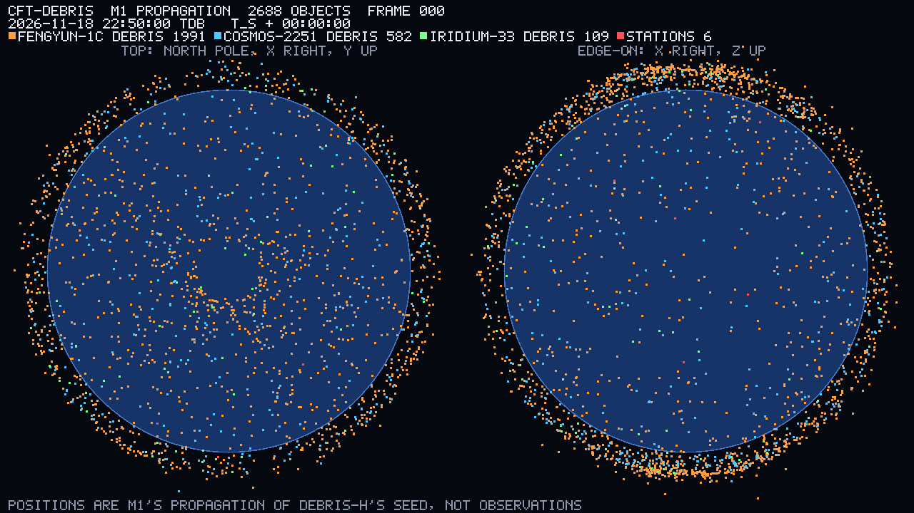

# cft-debris

Space-debris tracking and simulation, held to the methods of [HonestFramework](https://github.com/loganw234/HonestFramework) and [ParcelRound](https://github.com/loganw234/ParcelRound). It holds the rounds' studies and, since round DEBRIS-E, the first build: M1, a CPU reference propagator, in `src/`, with its gates in `tests/`. Round DEBRIS-F put M1 in the real Earth frame and ran it on CelesTrak's public orbit data. Round DEBRIS-G measured how many objects it carries in real time on the 36 threads of a second machine, amd-arc-box. Round DEBRIS-H ran it there as a 72-hour service, checking it against each CelesTrak update every 3 hours. Round DEBRIS-I wrote M1's force model as a cft program, run on libcft's software executor, which is the route to a GPU. Round DEBRIS-J ran that program on a consumer GPU, an RTX 5060 Ti, bit for bit with the CPU, and carried the tracked catalogue's day at 57.6 times real time at binary64 and 33.4 at binary256. Study DEBRIS-K asked whether M1 could give fuller forecasts for a few objects, decaying ones first. Parcel DEBRIS-L gave the project its first pictures: screenshots, a short video and a live display of the tracked population as M1 propagates it, and a panel of charts of the measured results.

*The 2,688 objects of DEBRIS-H's four groups at its start time, 2026-11-18 22:50:00 TDB, in M1's inertial frame: from above the North Pole (left) and edge-on (right), around the Earth's disc. The positions are M1's propagation of DEBRIS-H's seed, not observations; this is its first frame. Drawn by parcel DEBRIS-L.*

## The rounds

| round | question | status, 2026-11-23 | files in `studies/` |
|---|---|---|---|
| DEBRIS-A | Does REBOUND, and which of its integrators, suit long-term debris prediction? Received from cft-rebound's lead. | verified by verifier-A; its numbers reproduce, and the report lists its errata | `DEBRIS-A-rebound-for-debris.md`, `debris-a/`, `DEBRIS-A-verifier-A-report.md`, `PROVENANCE.md` |
| DEBRIS-B | What would a custom debris model stand on, cost and buy? It includes whether binary256 arithmetic buys anything. | verified by verifier-B; eight passages narrowed at the merge, each marked | `DEBRIS-B-plan.md`, `DEBRIS-B-custom-model.md`, `debris-b/`, `DEBRIS-B-report.md`, `DEBRIS-B-verifier-B-report.md`, `DEBRIS-B-round-record.md` |
| DEBRIS-C | The measurements that would decide between building, adopting existing tools, and a hybrid | checked by verifier-C; one defect, an attribution, and eight passages narrowed at the merge, each marked | `DEBRIS-C-plan.md`, `DEBRIS-C-measurements.md`, `debris-c/`, `DEBRIS-C-report.md`, `DEBRIS-C-verifier-C-report.md`, `DEBRIS-C-round-record.md` |
| DEBRIS-D | What a real-time, wide-precision propagator on a consumer GPU would cost, written in cft-fp256's language, and what it needs from cft-fp256 | checked by verifier-D; one defect, a marking bound that reached past its evidence; six narrowings and one addition at the merge, each marked | `DEBRIS-D-plan.md`, `DEBRIS-D-architecture.md`, `debris-d/`, `DEBRIS-D-report.md`, `DEBRIS-D-verifier-D-report.md`, `DEBRIS-D-round-record.md` |
| DEBRIS-E | Build M1 in six number kinds, native and libcft at binary32 and binary64 and libcft at binary128 and binary256, from one force-model source. Hold it to gates: native against libcft bit for bit, and against Lasser et al., JPL, Orekit and REBOUND | built, and checked by verifier-E; every gate passes as finally specified, and every re-run passed; five narrowings and one addition at the merge, each marked | `DEBRIS-E-plan.md`, `DEBRIS-E-build.md`, `debris-e/`, `DEBRIS-E-report.md`, `DEBRIS-E-verifier-E-report.md`, `DEBRIS-E-round-record.md`; the code is in `src/` and `tests/` |
| DEBRIS-F | Put M1 on real data: the IERS 2010 Earth frame from a binary256 node table, CelesTrak's GP data decoded by Orekit's SGP4, a native64 fit, and a first hindcast against later element sets | built, and checked by verifier-F; every gate passes, with no send-back; eleven narrowings and three additions at the merge, each marked, among them that the samples count docked vehicles, which share their station's element set, as separate objects; F9 re-run quiet on amd-arc-box, another machine, so the desktop's own clean timing is still to come | `DEBRIS-F-plan.md`, `DEBRIS-F-build.md`, `debris-f/`, `DEBRIS-F-report.md`, `DEBRIS-F-verifier-F-report.md`, `DEBRIS-F-round-record.md`; the code is in `src/` and `tests/` |
| DEBRIS-G | How many objects M1 carries in real time on amd-arc-box's 36 threads, at each number kind, and whether its results stay bit-identical across batch partitions and across machines | built, and checked by verifier-G; every gate passes, with no send-back; two narrowings and four additions at the merge, each marked. Real-time capacity at 36 threads runs from about 18.5 million objects at native32 to 4,332 at cft256: throughput, extrapolated beyond the 2,304 objects the runs carried. A 20-minute run held all 2,686 of S0's distinct element sets in real time at cft256 | `DEBRIS-G-plan.md`, `DEBRIS-G-build.md`, `debris-g/`, `DEBRIS-G-report.md`, `DEBRIS-G-verifier-G-report.md`, `DEBRIS-G-round-record.md`; the code is in `tests/` |
| DEBRIS-H | Run M1 as a 24/7 service: 72 hours on amd-arc-box, the catalogue's 2,688 objects at cft256 and native64, each new CelesTrak element set checked against it every 3 hours | built, run and checked by verifier-H, with no send-back; one narrowing and three additions at the merge, each marked. Of the long run's criteria, the fetches, the sanity bound (a median miss of 1.24 km under 24 hours), the checkpoints and the kinds pass. The checks and the pacing fail by their letters, kept so on Logan's rulings: three T3 hits came from distinct objects at their orbits' nodes, and two quiet hours began behind after nights beside another session's load | `DEBRIS-H-plan.md`, `DEBRIS-H-build.md`, `debris-h/`, `DEBRIS-H-report.md`, `DEBRIS-H-verifier-H-report.md`, `DEBRIS-H-round-record.md`; the code is in `tests/` |
| DEBRIS-I | Write M1's force model as a program in cft-fp256's language, and run it on libcft's software executor, held to cftc's reference interpreter and to M1 | built, and checked by verifier-I with no defect; three narrowings at the merge, each marked. The program has degree 7, the Sun, the Moon and drag, and no radiation pressure. It equals the interpreter bit for bit at four formats, and tracks M1 within the plan's tolerances over a day of 64 objects on amd-arc-box. At binary256 it runs 2.6 to 2.9 times M1's cft256 at the same forces. The degree-20 compile is not determined | `DEBRIS-I-plan.md`, `DEBRIS-I-build.md`, `debris-i/`, `DEBRIS-I-report.md`, `DEBRIS-I-verifier-I-report.md`, `DEBRIS-I-round-record.md`; the code is in `tests/` |
| DEBRIS-J | Run DEBRIS-I's cft program on a consumer GPU, the RTX 5060 Ti in WSL, through cft-fp256's GPU executor; hold it bit for bit to the CPU, and measure how many objects it carries | built, run on the card by the lead, and checked by verifier-J with no wrong answer; two corrections and one addition at the merge, each marked. The card equals amd-arc-box's CPU bit for bit over a day of 64 objects at binary64, binary128 and binary256. Its rate levels off at 2,048 objects a launch: 233,407 object-seconds a second at binary64 and 134,395 at binary256, 2.52 and 2.25 times the box's 36 threads on the same program. The tracked catalogue's day, 2,687 objects, ran at 57.6 and 33.4 times real time. The forces are the program's (degree 7, the Sun, the Moon and drag), not M1's full model | `DEBRIS-J-plan.md`, `DEBRIS-J-build.md`, `debris-j/`, `DEBRIS-J-report.md`, `DEBRIS-J-verifier-J-report.md`, `DEBRIS-J-round-record.md`; the code is in `tests/` |
| DEBRIS-K | Can M1 give fuller forecasts for a small set of objects, LEO objects likely to decay first, and refine itself from the results? A study, with a pilot hindcast on 16 low-perigee objects | checked by verifier-K; one defect, per-object values in three logs, fixed. 24 passages were narrowed at the merge, each marked, with a recount that counts each orbit determination once. Nothing beat SGP4 from the same latest set, and compute is not the limit at native64. Its recommendation, a decay watch scored against SATCAT and Space-Track, waits on four of Logan's decisions on data | `DEBRIS-K-plan.md`, `DEBRIS-K-study.md`, `debris-k/`, `DEBRIS-K-report.md`, `DEBRIS-K-verifier-K-report.md`, `DEBRIS-K-round-record.md`; the code is in `tests/` |
| DEBRIS-L | A first visual presentation of the project: screenshots, a short video and a live display of the 2,688 tracked objects as M1 propagates them over 3 hours, and a panel of charts of the rounds' measured results | made, and checked by verifier-L with no send-back; one cosmetic defect and two weak controls are recorded. On Logan's word, one picture, the two views at the start, is this README's. The video, the live display and the other pictures, which show per-object positions, stay in the project's ledger. This repository holds their code and the results panel, whose 29 numbers each name their source line | `DEBRIS-L-plan.md`, `debris-l/`, `DEBRIS-L-report.md`, `DEBRIS-L-verifier-L-report.md`, `DEBRIS-L-round-record.md`; the code is in `tests/` |

Every claim in a study carries a label: MEASURED, COMPUTED, READ, ESTIMATE or BELIEVED.

## Building M1

M1 needs an x86-64 CPU with FMA3, gcc, and libcft from cft-fp256 at commit 0aa997a3, built outside this repository. It was built and tested with mingw64's gcc 16.1.0 on Windows. `studies/DEBRIS-E-build.md` and `studies/DEBRIS-F-build.md`, each in its section 3, give every command and tool version.
- **The build,** with its object checks: `bash tests/build.sh <cft-fp256>/host <build dir>` for DEBRIS-E's gates, and `bash tests/build_f.sh <cft-fp256>/host <build dir>` for DEBRIS-F's, which adds the Earth frame and the fit.
- **The gates:** `python -I -B tests/<gate>.py`, with the build directory in `M1_BUILD` (DEBRIS-E) or `M1F_BUILD` (DEBRIS-F). They also need the inputs this repository does not redistribute (see below). `tests/gatelib.py` and `tests/f_lib.py` set the downloads, scratch and Python paths to this machine's.
- **On Linux:** F9's timing was also built and run on Ubuntu 24.04 with gcc 13.3.0, by `tests/f9_box.py`. It gives `tests/m1f.c`'s two Windows timers Linux clocks through a stand-in header, `tests/f9_box_windows.h`, and leaves every source unchanged.
- **At scale (DEBRIS-G):** `tests/g_stage.py` lays out a run folder, and `tests/g_harness.py` builds M1 with the batch driver `tests/m1g.c` and runs the gates from it, on Windows or Linux. `studies/DEBRIS-G-build.md`, section 1, gives the commands.
- **As a service (DEBRIS-H):** `tests/h_stage.py` stages a run folder. `tests/h_build.py` builds M1 with the driver `tests/m1h.c`, `tests/h_seed.py` fits the seed, and `tests/h_service.py` runs the tracks, the fetcher `tests/h_fetch.py` and the check `tests/h_check.py`, on Linux. `studies/DEBRIS-H-build.md`, section 2, gives the commands.
- **As a cft program (DEBRIS-I):** `tests/i_gen.py` writes the program's sources, and `tests/build_i.sh` builds M1's side, `tests/m1i.c`, and the driver, `tests/i_run.c`. `tests/i_harness.py` runs the gates. cftc and libcft come from cft-fp256 at commit 9e8ff270, on which M1's results equal 0aa997a3's bit for bit. `studies/DEBRIS-I-build.md`, section 1, gives the commands.
- **On a GPU (DEBRIS-J):** `tests/build_j.sh gpu` builds libcft with cft-fp256's GPU backend (HIP on NVIDIA's CUDA runtime) and the driver `tests/j_run.c`, in WSL. `tests/j_gpu.sh` runs each card step under a lock, and `tests/j_harness.py` runs the gates on the desktop and the card. `studies/DEBRIS-J-build.md` describes the build, the gates and the card's runs.
- **Pictures (DEBRIS-L):** `tests/l_prop.py` propagates DEBRIS-H's seed with M1's `m1f prop`, `tests/l_media.py` draws the screenshots, the video (assembled by ffmpeg) and the live display, and `tests/l_panel.py` draws the results panel from the committed records. `tests/l_gates.py` runs the gates V0 to V4.

## Checking the records

Each study's records come with SHA-256 manifests:
- DEBRIS-A: run `sha256sum -c SHA256SUMS` from `studies/`;
- DEBRIS-B to DEBRIS-L: run `sha256sum -c MANIFEST.sha256` from `studies/debris-b/`, `studies/debris-c/`, `studies/debris-d/`, `studies/debris-e/`, `studies/debris-f/`, `studies/debris-g/`, `studies/debris-h/`, `studies/debris-i/`, `studies/debris-j/`, `studies/debris-k/` and `studies/debris-l/`.

`.gitattributes` turns off line-ending conversion, so every file is checked out with its exact bytes. Many records end their lines with CRLF, and the checksums hold on any platform.

## Licence

MIT (`LICENSE`). It covers this repository's own work: the studies, their scripts and their records, and M1's code in `src/` and `tests/`. The software and data the studies and the build used are not included, and they keep their own licences:
- **Called through their interfaces, never copied in:** REBOUND (GPL-3.0), imported as an installed package; Orekit and Hipparchus (Apache-2.0); and cft-fp256's libcft and its compiler, cftc (Apache-2.0), built from a pinned commit outside this repository; AMD's HIP and NVIDIA's CUDA runtime, which DEBRIS-J's GPU build links in WSL; and ffmpeg, run as an installed program to assemble DEBRIS-L's video, which is not in this repository. M1 links libcft at build time; neither its sources nor its build are here. The systems in `studies/debris-d/systems/` and `studies/debris-i/systems/` are written in cft-fp256's language and are this repository's own. The images cftc compiles from them carry cft-fp256's routines, so they are not included; the records give each image's SHA-256 and the command that rebuilds it.
- **Named with their sources, never redistributed:** JPL's DE421, EIGEN-6C4, Lasser et al.'s benchmark data, the IERS Conventions' tables and the IERS Earth orientation data, USNO's table of TAI − UTC, and CelesTrak's orbit data and space weather.

## What is not here

- **Machine-specific paths:** the paths inside the records are those of the machine where the runs were made, and so are the defaults in `tests/gatelib.py`.
- **Executables:** M1's builds, `m1x.dll` and libcft's build stay outside the repository. Every gate log names the SHA-256 of the binaries it ran.
- **Third-party inputs** are not redistributed: Orekit and Hipparchus, JPL's DE421, the files of Lasser et al.'s 2020 benchmark, cft-fp256's sources, the gravity-field sources DEBRIS-D generated from EIGEN-6C4, the IERS and USNO tables, and CelesTrak's GP data and space-weather files. Each study names where they came from, and `studies/debris-d/q2/gen_field.py` regenerates the field sources byte for byte.
- **Per-object tables** derived from CelesTrak's GP data, such as DEBRIS-F's fits and hindcast pairs, DEBRIS-G's population and final states, DEBRIS-H's seed, checkpoints, fetched sets and check tables, DEBRIS-I's sample, boundary states and per-object tables, DEBRIS-J's INIT and runs files and the card's per-object outputs, DEBRIS-K's per-object checks, fits, candidate tables and orbit values, and DEBRIS-L's video, live display and other pictures of the population with the states behind them, stay in the project's ledger. The repository holds their aggregates, and one control's figures for one public object, the ISS (`studies/DEBRIS-F-build.md`, section 9).
- **The project's ledger** is not part of this repository. It holds the hashes recorded at download, and the lead's rulings during each round.
